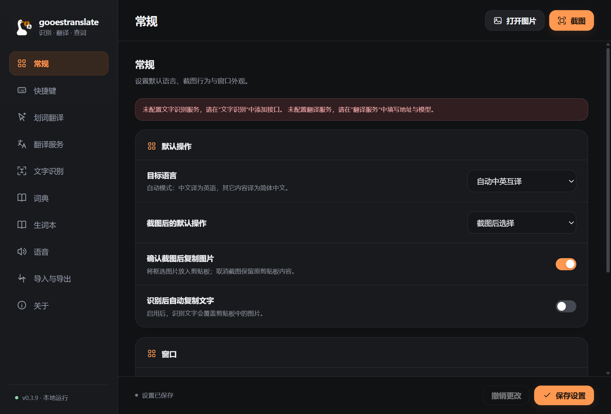
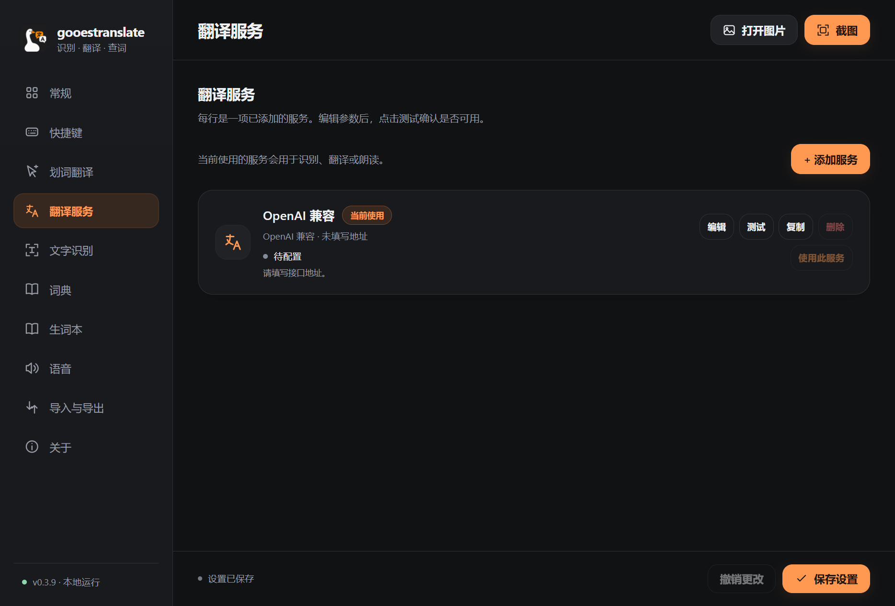
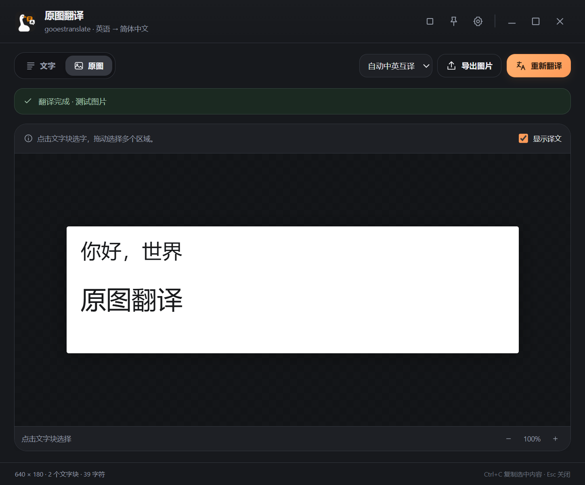
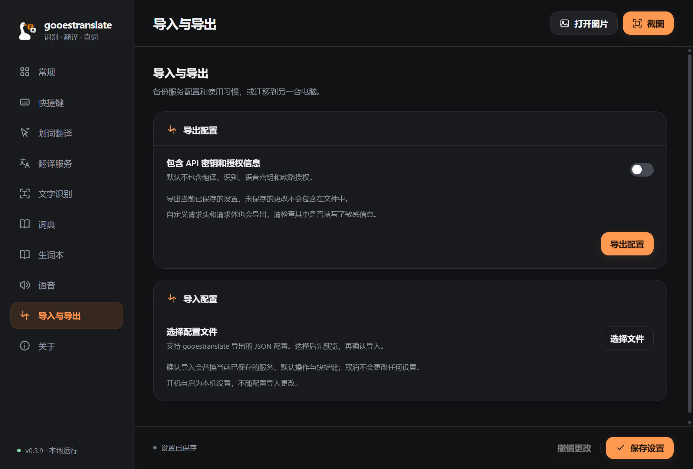
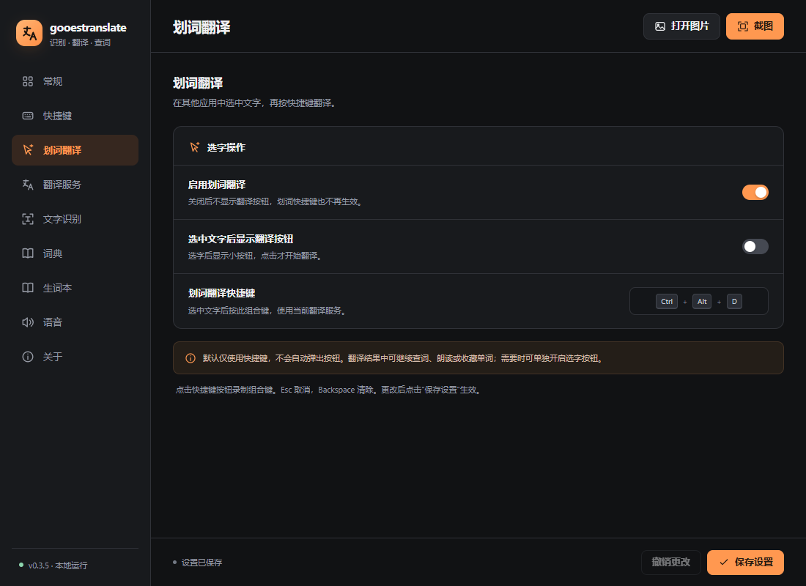
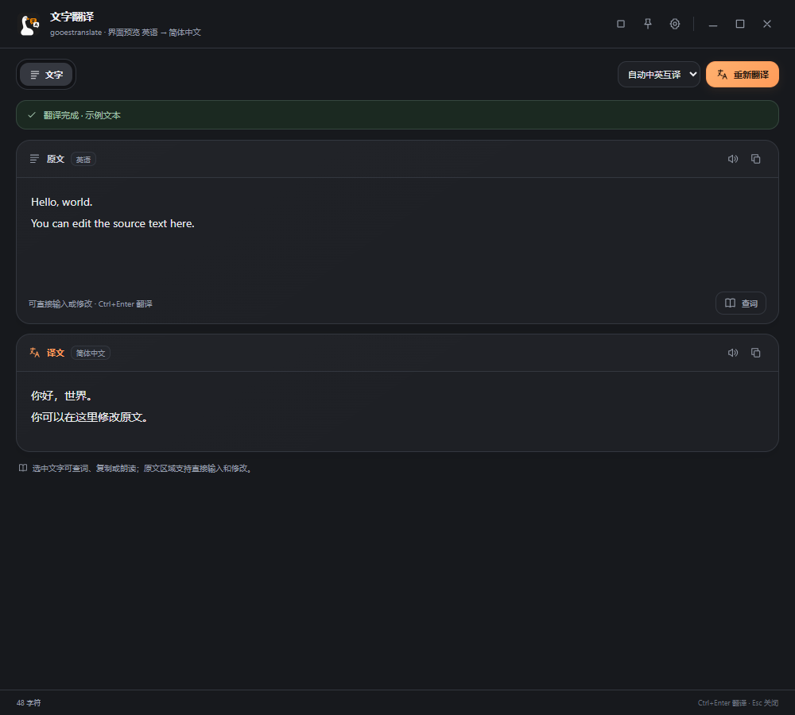
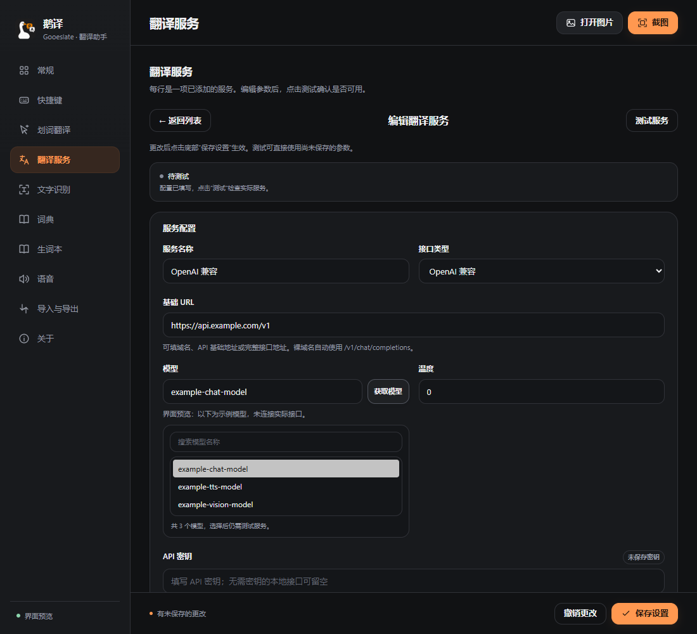
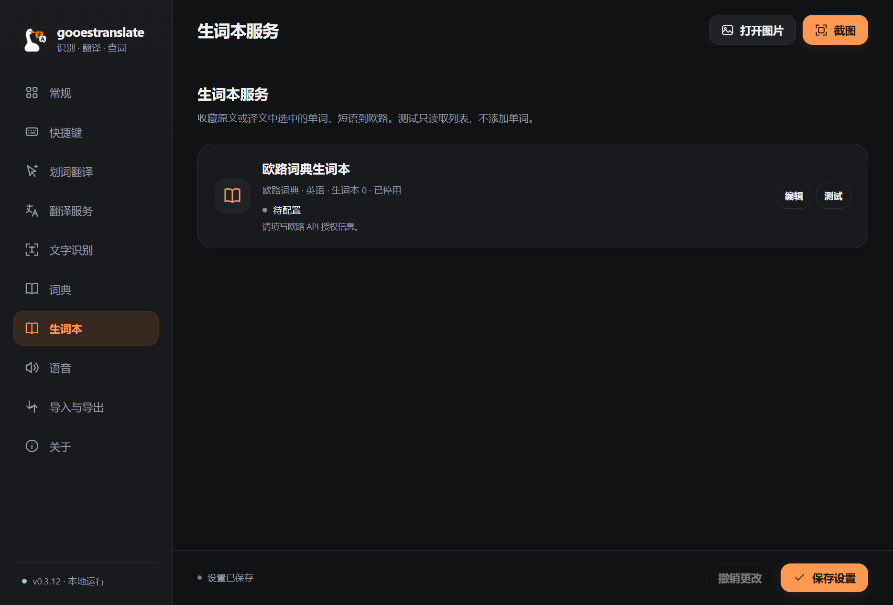

# gooestranslate

用 Go 实现的 Windows 桌面翻译工具。主窗口是设置中心，日常通过托盘或快捷键截图，在独立结果窗口完成文字识别、翻译、原图选字、查词、收藏和朗读。服务列表提供独立编辑和测试，显示当前使用项、配置缺失及最近测试结果。**v0.3.9** 使用鹅与中英文对话气泡作为应用图标，统一程序文件、窗口、托盘、桌面快捷方式及界面标识。结果窗口使用自带的拖动区、最小化和最大化按钮。配置导入与导出可备份服务、提示词、请求体和快捷键，默认不导出密钥。划词翻译默认通过 `Ctrl+Alt+D` 触发。

截图工具使用 Win32 绘制，设置与结果界面使用内嵌 WebView2。运行程序需要 Microsoft Edge WebView2 Runtime，无需 Node、Python 或额外插件运行环境。

界面示例（示例配置与文本）：







## 开始使用

1. 运行 `gooestranslate.exe`，在“翻译服务”“文字识别”“语音”列表点击“添加服务”，选择类型，填写服务地址、模型和需要的密钥。点击“测试”确认服务与响应格式，再选择当前使用项并保存。新安装不包含个人服务地址或密钥；Windows 系统朗读无需网络配置。
2. 按 `Ctrl+Shift+S` 框选图片，松开鼠标后在操作栏选择“识别”“翻译”或“原图翻译”。也可以在托盘右键菜单直接开始对应操作，或从设置中心打开 PNG / JPEG 图片。
3. 在结果窗口切换“文字”和“原图”视图。选中文字可以复制、查词或朗读；支持坐标的 OCR 还允许在原图中点击文字块、拖动框选及 `Ctrl` 增选。
4. 选择目标语言，点击“翻译”查看译文；勾选“显示译文”在原图相应位置覆盖译文，点击“导出图片”保存 PNG。配置欧路生词本后，可显式点击“收藏”保存选中的原文单词。

解压包内运行 `创建桌面快捷方式.ps1` 可以在桌面建立快捷方式，图标与程序窗口保持一致。该脚本只创建本用户的快捷方式；请将解压目录放在长期使用的位置。

关闭设置窗口默认收起到托盘，程序继续等待快捷键。双击托盘图标打开设置，右键菜单可以退出程序。关闭结果窗口只收起当前结果。

翻译结果窗口使用自带的标题区，不再叠加系统标题栏。拖动标题区移动窗口，双击标题区最大化或还原；标题区右侧可最小化、最大化或还原、置顶、打开设置及关闭。普通窗口四边和四角仍可缩放，最大化避开任务栏，原图选字区域不参与拖动。设置窗口保持标准系统标题栏。

截图会检查是否读回完整像素，并在重绘失败时尝试全量重绘；仍失败时取消这次截图并提示重试，避免把不完整图像送入剪贴板或识别服务。回归测试只使用合成图。若仍出现色块，请记录它是否只出现在框选遮罩中，以便继续定位采集或重绘环节。

## 设置与快捷键

设置中心包含常规、快捷键、划词翻译、翻译服务、文字识别、词典、生词本、语音、导入与导出和关于。支持深色、浅色和跟随系统的主题，圆角卡片与按钮提供短暂的切换和悬停动画；Windows 开启“减少动画”时会停用这些动画，原图的大小和文字坐标不参与动画。

“常规 → 开机自启”默认关闭，修改后点击“保存设置”生效。启用时仅为当前 Windows 用户登记本程序，登录后在托盘运行；关闭时移除该登记项。读取或写入失败会提示错误，设置或快捷键保存失败会恢复原来的自启设置。双击桌面快捷方式会打开设置；已运行时不会再建立一个实例。自启路径跟随当前可执行文件，移动程序后先关闭并保存，再开启并保存即可更新路径。

翻译、OCR 和 TTS 分别保存多个服务配置，可添加通用预设、复制、删除及选择默认服务。复制服务会复制参数并清空新服务的密钥，需要重新填写。保存后快捷键和默认服务立即生效。

服务页默认显示列表，点“编辑”进入对应配置，点“返回列表”保留尚未保存的草稿；新增服务以独立按钮打开类型选择。提示词与请求体保留自定义能力，并折叠在编辑页中。“密钥已保存”只表示存在凭据，不表示服务已经测试可用。列表分别显示缺少地址/模型等配置、待测试、测试通过、测试失败或修改后需重测；修改默认项在保存前标明“保存后使用”。每类至少保留一个服务配置。

测试按钮使用当前草稿和对应已保存密钥，不保存服务配置：翻译发送生成的短文本并检查译文格式；OCR 上传生成的 HELLO 图片并检查文字及坐标；远程语音生成短音频，检查 WAV/MP3 返回，系统语音检查可用发音人，两者均不播放；模型/离线词典检查释义；欧路只读取列表并核对 ID，不执行收藏。测试记录保存为本地 `service-tests.json`，只包含配置摘要哈希与结果，不保存明文密钥。重开应用时保留匹配配置的最近结果并显示测试时间；连接参数、密钥或本地词典文件变化后需重新测试。最近一次成功不代表接口始终在线。

默认快捷键：

| 快捷键 | 操作 |
| --- | --- |
| `Ctrl+Shift+S` | 截图工具，执行配置的默认操作；初始为截图后选择 |
| `Ctrl+Alt+O` | 截图后识别文字 |
| `Ctrl+Alt+T` | 截图后识别并翻译文字 |
| `Ctrl+Alt+I` | 截图后识别并在原图位置显示译文 |
| `Ctrl+Alt+D` | 翻译其他应用中选中的文字 |

点击快捷键按钮，按下新组合即可录制；录制期间暂停本程序的全局快捷键，完成、取消或窗口失焦后恢复。支持 Ctrl / Alt / Shift / Win 与字母、数字、F1–F24、空格组合；`Esc` 取消录制，`Backspace` 或 `Delete` 清除快捷键。被其他程序占用的组合会显示错误。

“确认截图后复制图片”默认启用，确认框选时将图片写入剪贴板；按 `Esc` 取消截图不会改变原剪贴板。若启用“识别后自动复制文字”，成功识别后文字会覆盖剪贴板中的图片。图片复制失败会提示错误，但识别与翻译仍可继续。

## 配置导入与导出

设置侧栏点击“导入与导出”：

- **导出配置**：选择 JSON 文件保存位置。导出的是已保存的设置，包括服务、当前使用项、提示词、请求头与请求体、OCR 坐标格式、语音、生词本、主题、截图行为和快捷键；未保存的编辑草稿不包含在内。
- **包含 API 密钥和授权信息**：默认关闭。关闭时移除专用密钥和常见授权字段，并保留 `{{api_key}}` 等模板变量。自定义请求可能嵌有其它敏感内容，分享前请检查文件。勾选后凭据以明文写入导出文件，适合个人备份和迁移，请妥善保管。
- **导入配置**：选择本软件导出的 JSON（最大 2 MB），先查看服务数量和凭据摘要，再确认导入。导入替换全部已保存设置及未保存的草稿，不会合并或借用当前服务的密钥；不含密钥的配置需重新填写凭据。取消、格式错误或快捷键注册失败不会替换当前设置。导入成功后请重新测试服务。

跨电脑导入时，专用密钥字段中的 API 密钥和欧路授权会在目标电脑重新加密保存；不会把原电脑绑定的加密数据放入导出文件。自定义请求头或请求体中的授权字符串仍按配置文本保存。离线词典只导出文件路径，不打包词典内容，需在新电脑重新选择对应文件。导出不包含历史结果、图片和本机连接测试记录。开机自启为本机设置，不导出，也不会被导入配置更改。



## 划词翻译

在浏览器、编辑器等应用中选中文字，再按 `Ctrl+Alt+D`。结果窗口显示原文、译文和自动中英互译方向，可修改目标语言重新翻译，也可选词查词、显式收藏到欧路生词本、复制或朗读。划词翻译直接使用当前翻译服务，不经过截图和 OCR。设置中可停用划词翻译或录制自己的快捷键，保留原有服务配置。

程序优先通过 Windows UI Automation 读取选区。应用未提供选字接口时，快捷键会尝试兼容复制：等待修饰键松开，备份剪贴板，向仍在前台的窗口发送 `Ctrl+C`，只读取新产生且来自该应用的内容，再恢复原剪贴板。若读取后用户又复制了新内容，保留较新的剪贴板；无法完整备份的格式会在发送复制操作前报错。没有选中内容、密码框、权限限制或切换窗口时不会使用旧剪贴板翻译。应用明确提供空选区时不尝试复制当前整行。某些应用不支持选字或不接受复制，此时可使用截图识别。

“选中文字后显示翻译按钮”为可选项，默认关闭；开启后仅在支持选字读取的应用中，被动读取鼠标拖选或双击的选区，点击“译”按钮才发起翻译。该方式不使用兼容复制，不改变剪贴板。关闭功能或退出程序会卸载鼠标钩子；本程序自己的窗口与截图操作不会触发划词。





## 翻译服务与语言

可选择 OpenAI 兼容、Ollama 或自定义 HTTP 预设。OpenAI 兼容服务只填域名时，自动使用 `/v1/chat/completions`；填写 API 基础路径时保留该路径并补全 `/chat/completions`，也接受完整接口地址。模型查词及 OpenAI 视觉识别使用相同规则；兼容语音的裸域名自动使用 `/v1/audio/speech`。自定义 HTTP 使用填写的完整地址，不添加路径。

模型输入框右侧的“获取模型”使用当前草稿地址、请求头和密钥查询 `GET /models`，无需先保存或填写模型。已有服务留空密钥时复用该服务已保存的凭据；新建或复制服务不会借用其他服务的密钥。列表支持搜索和点选，选择后仍可手动修改，点击保存设置生效。查询失败、列表为空或没有匹配项时保留原模型；修改连接参数后旧列表会失效。获取列表不代表所选模型已通过翻译、视觉或语音测试，仍需按实际用途点击“测试服务”。



| 填写的 OpenAI 兼容地址 | 实际翻译请求地址 |
| --- | --- |
| `https://api.example.com` | `https://api.example.com/v1/chat/completions` |
| `https://api.example.com/v1` | `https://api.example.com/v1/chat/completions` |
| `https://api.example.com/proxy/openai` | `https://api.example.com/proxy/openai/chat/completions` |
| `https://api.example.com/chat/completions` | 保留完整地址 |

如果测试提示“服务返回了 HTML 网页而非 JSON”，请求可能到达了管理网页或错误路径，请核对供应商提供的 API 地址。

目标语言默认“自动中英互译”，也可固定为简体中文、繁体中文、英语、日语或韩语。自动模式使用简单启发式：文本包含汉字且汉字至少占字母字符的一半时译为英语，其它内容译为简体中文。结果窗口显示推定的原文语言与实际目标语言，并可单独调整本次翻译目标。这不是完整语言检测，混合语言或其它语种内容建议手动指定目标语言。

每个翻译服务可独立设置模型、温度、超时、System Prompt 和 User Prompt。默认提示词要求返回与输入文字块一一对应的 JSON 数组：

```json
[
  {"id": 0, "text": "你好"},
  {"id": 1, "text": "翻译文字"}
]
```

原图翻译依赖这些 `id` 对应关系，修改提示词时应保留格式及顺序。自定义接口也可返回与输入行数相同、按原顺序逐行排列的纯文本译文。

勾选“关闭模型思考”会在翻译及模型词典请求中合并以下字段，保留 `chat_template_kwargs` 的其它内容：

```json
{"chat_template_kwargs": {"enable_thinking": false}}
```

服务不支持该字段时取消勾选。此开关不能保证所有供应商或模型都关闭思考。

## 提示词、请求头与完整 JSON

“标准 OpenAI 请求”根据模型、温度和提示词构造非流式 Chat Completions 请求。“完整 JSON 请求”使用编辑器中的请求体；可同时设置请求头 JSON 及译文响应路径。自定义 HTTP 预设默认使用完整 JSON。

模板必须是有效的 JSON 对象，变量放在 JSON 值中。完整变量值会保留原类型，例如 `"messages": "{{messages}}"` 会替换为消息数组，`"speed": "{{speed}}"` 会替换为数字；嵌入字符串的变量会作为文本替换，并由 JSON 编码处理引号和换行。

```json
{
  "model": "{{model}}",
  "messages": "{{messages}}",
  "temperature": 0,
  "stream": false
}
```

| 变量 | 内容 |
| --- | --- |
| `{{text}}` | 当前任务的文字；翻译时为逐行原文，查词时为单词 JSON，TTS 时为朗读文本 |
| `{{lines}}` | 含 `id`、`text` 的翻译输入数组 |
| `{{messages}}` | 已渲染提示词构成的消息数组；视觉 OCR 时包含图片消息 |
| `{{target_language}}` / `{{source_language}}` | 当前翻译目标与启发式推定的原文语言 |
| `{{model}}` / `{{api_key}}` | 当前服务配置的模型与密钥 |
| `{{image_base64}}` / `{{image_data_url}}` | OCR 上传图片的 JPEG Base64 / Data URL |
| `{{image}}` | 按 OCR“图片编码”设置选择的 Base64 或 Data URL |
| `{{voice}}` / `{{speed}}` | TTS 发音人与语速倍率 |

变量按任务提供，图片变量用于 OCR，文字块变量用于翻译，发音变量用于 TTS。未用于当前任务的变量为空值。未知变量、未闭合变量、无效 JSON 和流式请求会被拒绝；`stream` 如存在必须是布尔值 `false`。

响应路径支持点号和数组索引，例如 `choices.0.message.content`、`choices[0].message.content`、`data.translations`。OCR 直接返回数组时可留空响应路径。请求头 JSON 的值必须是字符串，可使用 `{{api_key}}`；已填写密钥时默认发送 `Authorization: Bearer ...`，自定义请求头可覆盖授权方式。不要手工填写 `Host`、`Content-Length` 或 multipart 的边界。

各服务及欧路请求超时可设置为 **1000–600000 毫秒**，按所选服务配置生效。接口请求不跟随重定向，请填写最终服务地址。取消任务或新截图后，过期结果不会覆盖新任务的界面；保存设置会取消待处理的查词、收藏和朗读，已在服务器完成的收藏不能撤回。

## OCR 协议与坐标

OCR 将图片编码为 JPEG 后发送到当前默认识别服务，支持三种协议：

| 协议 | 上传方式 | 配置要点 |
| --- | --- | --- |
| HTTP 表单上传 | `multipart/form-data` 图片文件及附加字段 | 完整接口地址、图片字段名、附加表单字段 JSON |
| JSON 请求 | Base64 或 Data URL 图片 | 完整接口地址、图片编码、图片字段名或完整 JSON 请求体 |
| OpenAI 视觉 | Chat Completions 的图片消息 | 基础或完整地址、视觉模型；也可自定义完整请求体 |

表单字段 JSON 中字符串按原样发送，其它值转为 JSON 文本。例如要求大小写固定的服务可填写 `{"return_word_box":"True"}`；布尔值 `true` 会发送文本 `true`。multipart 的 `Content-Type` 边界由程序生成。

坐标解析支持配置响应路径、文字字段、坐标字段和格式。字段可以使用点号路径，例如 `data.items`、`content.value`、`region`。

```json
[
  {"text": "Hello", "box": [[10, 20], [100, 20], [100, 50], [10, 50]]}
]
```

坐标单位为上传图片的像素：`quad` 为四点数组，`xywh` 为 `[x,y,width,height]`，也支持含 `x`、`y`、`w`/`width`、`h`/`height` 的对象。视觉 OCR 开启坐标时会请求模型返回文字块 JSON，但坐标准确性取决于模型。

只返回文本的接口应关闭“启用文字坐标”。此时仍可识别、翻译文字、查看和导出原图；原图文字框选择与译文覆盖会禁用。开启坐标但响应缺少有效坐标时会报错，不会生成虚假位置。

## 词典与欧路生词本

默认查词来源为模型词典，也可使用离线词典：

- **模型词典**：使用当前默认翻译服务生成释义和音标，界面标明 AI 词典来源。自定义翻译接口用于查词时，也需要能返回程序要求的词条 JSON。
- **离线词典**：加载本机 JSON 或 ECDICT CSV 文件，按输入单词查询，忽略大小写，无需网络。

JSON 文件采用单词到字符串、释义数组或词条对象的映射，例如：

```json
{
  "hello": "int. 你好；喂",
  "translate": ["v. 翻译", "v. 转化"],
  "workflow": {
    "word": "workflow",
    "phonetic": "ˈwɜːkfləʊ",
    "definitions": ["n. 工作流程"]
  }
}
```

ECDICT CSV 需要 `word` 列及 `translation` 或 `definition` 列，可选 `phonetic` 列。JSON 文件最大 32 MB，CSV 最大 256 MB；词库由用户准备，项目未捆绑词库，可从 [ECDICT 官方项目](https://github.com/skywind3000/ECDICT)获取。本程序未接入 Manggo 的云词库。

在“生词本”中启用欧路，点击“获取欧路授权”，在默认浏览器打开 [官方授权页面](https://my.eudic.net/OpenAPI/Authorization)，复制页面显示的授权值，粘贴到“API 授权信息”。选择生词本语言，填写生词本 ID；默认生词本填 `0`，也可获取账户列表后选择。获取列表不是必需步骤，可使用未保存的授权草稿；读取列表不会保存授权，实际收藏使用已保存的配置。

官方 API 基础地址已预设为 `https://api.frdic.com/api/open/v1`，通常无需修改；代理接口可以在“高级连接设置”中配置，并提供恢复默认按钮。授权网页用于获取授权值，不能填入 API 基础地址；保存设置与获取列表前都会拦截此类误填。读取 v0.3.0 已保存的误填网页地址时，会恢复官方 API 地址，保留原授权、语言与生词本 ID。



程序按官方协议发送 `Authorization: NIS <Token>`，输入框接受裸 Token 或带 `NIS ` 前缀的授权值。生词本 ID 全程使用**字符串**，避免长 ID 在 JavaScript 中丢失精度；默认生词本为 `"0"`。请求参数与授权说明见 [欧路生词本 OpenAPI 文档](https://my.eudic.net/OpenAPI/doc_api_study)。

仅在结果窗口显式点击“收藏”时，选中的原文单词或短语才会发送到账户。识别、翻译、查词不会自动收藏；模型把词条显示为小写或词形还原后，收藏仍保留用户选择的原文。收藏支持不超过 150 个字符的单词或短语，英语生词本拒绝包含汉字的选择。

欧路公开的 `/studylist/word` 查询用于获取账户生词本中的已有词条，不能当作任意单词的通用词典；日常查词使用模型或离线词典。接口范围以 [官方开发指南](https://my.eudic.net/OpenAPI/doc_api_study)为准。

## 朗读服务

TTS 可分别配置多个服务，并选择默认服务：

- **Windows 系统语音**：使用本机 SAPI，声音来自 Windows 已安装的语音，语速为 -10 到 10。
- **OpenAI 兼容语音**：发送 `/audio/speech` 请求，可配置模型、发音人和语速倍率；默认请求 WAV，也可通过完整请求体选择服务支持的 MP3。
- **自定义 HTTP**：向完整接口地址发送 JSON，可自定义请求头、文字字段和完整请求体。

网络语音支持直接返回 WAV / MP3，或 JSON 顶层 `base64`、`audio`、`data` 字符串中的 Base64 / Data URL 音频；暂不支持嵌套音频响应路径和远程音频 URL。云端语速倍率为 0.25–4，单次朗读不超过 50000 个字符，音频响应不超过 64 MB。

可以朗读原文、译文或所选词语，停止正在获取或播放的语音，或启用翻译后自动朗读。错误会显示在结果窗口，不清空识别和翻译结果。网络音频使用临时本地文件播放，播放完成、停止或退出时清理；当前没有音频导出入口。

## 本地设置与数据流

设置保存在 `%APPDATA%\gooestranslate\settings.json`。翻译、OCR、TTS 密钥及欧路 Token 使用 Windows DPAPI 加密，通常只能由同一 Windows 用户解密。设置页面不返回已有密钥明文；留空保留已有值，填写新值更新，勾选清除后保存可删除。旧版本的单服务设置会迁移为服务配置。

请求头和请求体模板是普通配置文本；在模板中引用 `{{api_key}}`，不要把密钥直接写成模板里的字面量。

图片只发送到所选 OCR 服务。翻译和模型查词发送文字；网络 TTS 发送朗读文本；欧路显式收藏发送选中的原文。离线词典和系统朗读使用本机资源。

WebView2 用户数据位于同一目录的 `WebView` 子目录。个人配置和测试输出不应提交到源代码仓库。

## 构建与验证

图标源图保存在 `assets/app-icon-source.png`。多尺寸透明 ICO、界面 PNG 和 Windows 资源已经包含在仓库中；需要重新生成时运行 `./scripts/build-icon.ps1`（使用固定版本的 rsrc 工具，不影响运行时依赖）。

Windows 10/11 x64，Go 1.23 或更高版本。依赖通过 Go Modules 获取，不需要 C 编译器。界面运行需要 [Microsoft Edge WebView2 Runtime](https://developer.microsoft.com/en-us/microsoft-edge/webview2/#download-section)，可使用官方 Evergreen 安装程序。

```powershell
go mod download
go test ./...
go build -trimpath -ldflags="-s -w -H windowsgui" -o dist/gooestranslate.exe ./cmd/gooestranslate
```

构建带控制台输出的验证程序：

```powershell
go build -o dist/gooestranslate-check.exe ./cmd/gooestranslate
./dist/gooestranslate-check.exe --smoke-test test-artifacts
./dist/gooestranslate-check.exe --ui-smoke-test test-artifacts
./dist/gooestranslate-check.exe --render-smoke-test test-artifacts
```

`--smoke-test` 检查截图缓存与操作栏、译文图片导出、DPAPI 和系统声音枚举。`--ui-smoke-test` 检查 WebView2 页面逻辑、设置和结果通信、密钥字段隔离，以及原图结果推送；它不显示窗口，不能单独验证画面正常。

`--render-smoke-test` 会显示设置和结果窗口，使用 WebView2 CapturePreview 保存应用自身的画面并检查 PNG 像素。覆盖首次打开、隐藏后恢复、最小化后恢复、最大化及还原，同时检查控制器可见状态和尺寸，并逐页验证翻译、OCR、生词本、TTS 设置页的切换与渲染。失败时写入诊断报告并以非零状态退出。三个测试都不截取真实桌面、不调用外部接口、不写入个人设置、不播放朗读音频。

配置本机服务后，可显式运行真实接口测试。它上传程序生成的测试图片，执行 OCR、翻译和模型查词，可能产生少量 API 用量：

```powershell
./dist/gooestranslate-check.exe --live-test test-artifacts
```

测试图片、译文预览和结果 JSON 写入 `test-artifacts`，该目录已在 Git 中忽略。单元测试还覆盖多服务选择、自定义请求与模板、坐标解析、WAV/MP3、欧路授权及字符串生词本 ID；这些协议测试使用本地模拟服务。

## 当前限制

- 目前没有翻译历史管理、完整生词本浏览/同步或内置本地 OCR 模型；自定义接口仍须符合支持的请求和响应结构。
- 所有网络服务使用非流式请求。翻译每次支持 1–300 行，输入 JSON 最多 60000 字节；较大截图可能需要分区处理。
- 自动语言判断是中英启发式，不是多语种检测器；模型生成的释义与视觉坐标可能不准确。
- 译文采用白底覆盖和字体缩小，不做背景修复或复杂版面重排；对齐以文字行为单位。旋转文字、小字号、复杂排版和过长译文可能影响效果。
- 离线词典按输入词语直接查询，不提供完整的词形还原或模糊搜索。
- 云端语音播放器仅支持 WAV/MP3，不支持 Ogg、FLAC 或音频导出；系统可用声音取决于本机安装情况。
- 自动验证不能替代真实桌面框选和混合 DPI 多屏的使用验收。
- EXE 尚未进行代码签名。

## 项目结构

- `internal/engine`：服务配置、请求模板、OCR、翻译、词典、生词本、语音获取、坐标处理与协议测试。
- `cmd/gooestranslate`：Win32 截图、WebView2 通信、托盘、快捷键、SAPI、网络音频播放、加密设置、剪贴板与导出。
- `cmd/gooestranslate/ui`：设置中心与结果窗口的内嵌页面。
- `.github/workflows/build.yml`：Windows 构建与测试。
